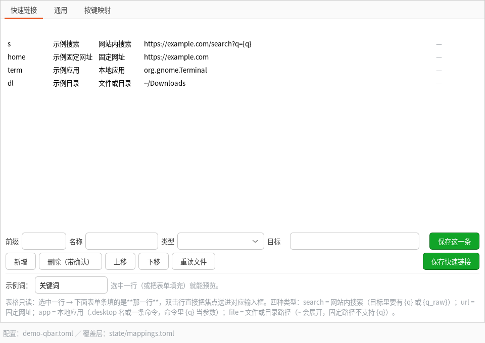
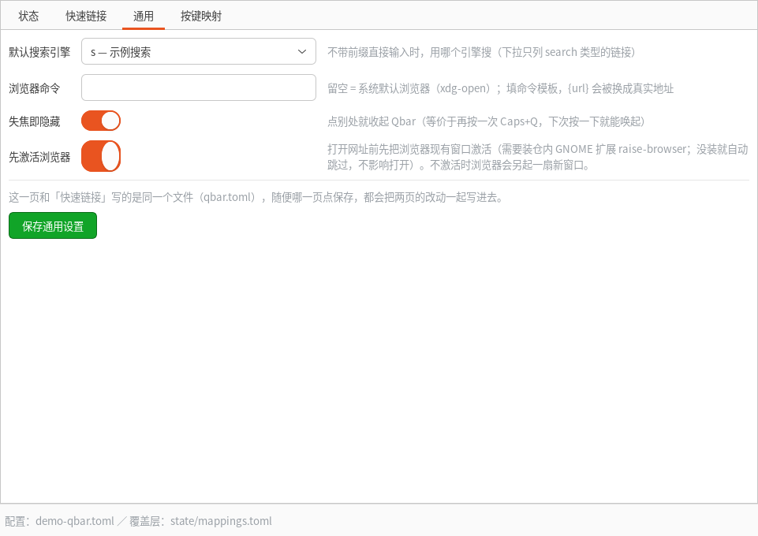
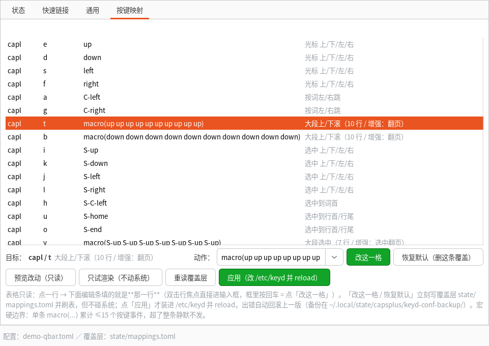

# capsplus —— Capslock+ 的 Linux 移植（keyd + GTK3）

**一句话**：把 Windows 上 **Capslock+ v3.3.0** 的核心用法搬到 Linux —— 按住 CapsLock 进一层
导航/编辑键，外加一个托盘、一个 Qbar 启动器和一个图形设置界面。键位映射的**唯一真相源**是
`capsplus/mapping_data.py`，keyd 配置与下面的键表都由它渲染（改映射不用改两处）。

<!-- 徽章纪律：没有真跑过的 CI 就不许放假徽章（这条注释留着提醒后来人） -->
[](https://github.com/517477981/capsplus-linux/actions/workflows/tests.yml)
[](LICENSE)
[](#依赖)

**许可**：GPL-2.0-only（本仓的按键映射表译自上游 CapsLock+，属衍生作品）——
出处、改动清单与分发要求见下面「[许可与上游](#许可与上游)」一节，全文见 [`LICENSE`](LICENSE)。

**截图**（都是 `xvfb-run` 在虚拟显示里拍的，`python3 tools/make-screenshots.py` 可重拍）：

| 快速链接 | 通用 | 按键映射 |
|---|---|---|
|  |  |  |

界面数据来自 [`assets/screenshots/demo-qbar.toml`](assets/screenshots/demo-qbar.toml)（五条 example.com 假链接），
不是任何人的真实配置。**你自己放截图之前先读** [`docs/PRIVACY.md`](docs/PRIVACY.md) —— 底部状态栏会写着配置文件路径，
表格里 `q` 那行会写着 `command(<你的 bindir>/keyd-qbar-cmd)`，而 `qbar.log` 的 `activate` 行带搜索关键词。
## 依赖

| 依赖 | 版本 / 说明 | 必需性 |
| --- | --- | --- |
| Linux + **keyd** | 实测 **2.5.x**。Debian/Ubuntu 的包把它装成 `keyd.rvaiya`，Arch/Fedora/openSUSE 装成 `keyd` —— 本仓两个名字都试（`capsplus/env.py`） | 必需（没它整套键位都不成立） |
| **Python** | **≥ 3.11**（用了标准库 `tomllib`，除此之外零第三方依赖） | 必需 |
| **GTK3 + PyGObject** | `python3-gi` `gir1.2-gtk-3.0` | 必需（Qbar / 托盘 / 设置窗口） |
| **AyatanaAppIndicator3** | `gir1.2-ayatanaappindicator3-0.1` + GNOME 的 `ubuntu-appindicators` 扩展 | **可选** —— 没装就没托盘图标，其余功能不受影响 |
| `fd` / `fdfind` | Debian/Ubuntu 叫 `fdfind` | 可选（只影响 Qbar 搜文件） |

**实测平台**：Ubuntu 26.04.1 LTS + GNOME Shell 50.1 + 纯 Wayland（`loginctl show-session … -p Type` → `wayland`）。
其余发行版做的是"名字与路径可移植"的功课，**还没在别的发行版上真装过一遍** ——
硬要列支持面的话：`keyd` 支持的 Linux 都算潜在可用，桌面侧限制一律见
[`docs/KNOWN-LIMITS.md`](docs/KNOWN-LIMITS.md)（13 条编号 + 按日期追加的实测记录，
每条都带**实测日期**与**复现方法**）。

## 快速上手（三条命令）

```bash
./install.sh                 # ① 装用户侧：bin 软链 + 应用菜单入口 + autostart + 依赖检查
capsplus render | less       # ② 先看渲染出来的 keyd 配置，不动系统
capsplus apply               # ③ 装进 /etc/keyd 并 reload（先备份，keyd 报错自动回滚）
```

`install.sh` **不碰 `/etc/keyd`**，③ 这一步是你自己按下去的。之后：

```bash
capsplus status              # keyd 服务/程序路径/当前配置摘要/与渲染是否一致
capsplus-qbar                # Qbar（Caps+Q 由 keyd 唤起）
capsplus-settings            # 设置窗口：快速链接 / 通用 / 按键映射
```

## 让浏览器在**原窗口开标签页**（可选，需要装一个 GNOME 扩展）

不装也能用，只是会有这个现象（2026-10-16 实测）：**焦点不在浏览器时，Qbar 打开网址会另起一扇浏览器窗口**，
之后 Qbar 打开的页面全堆在那扇窗里；焦点本来就在浏览器上时才会正常开标签页。

根因不在我们这边：`GTK3 递不出 Wayland 激活令牌`（实测 `libgdk-3` 里字符串
`XDG_ACTIVATION_TOKEN` 出现 0 次）。没有令牌，`mutter` 不允许浏览器把已有窗口拉到前台，
浏览器为了让你看得见就只能新画一扇窗。

所以仓里带了一个 **~120 行的 GNOME Shell 扩展**：它跑在 mutter 进程内，
`Meta.Window.activate()` 是它自己的特权动作，不需要令牌。Qbar 打开网址前先经 D-Bus 请它把
浏览器的窗口激活，再打开 —— 此时焦点在浏览器上，走的就是"开标签页"那条路。
**扩展没装 / 没应答时 Qbar 照原样打开网址**（实测 `gdbus` 7 毫秒返回错误，不卡界面），
所以这是一个纯增益、可静默失效的开关。

```sh
sh tools/install-extension.sh     # 复制到 ~/.local/share/gnome-shell/extensions 并加进启用列表
# ⚠ 必须**注销再登录**一次：GNOME Shell 只在启动时扫描用户扩展目录，
#    当场 `gnome-extensions enable` 会报「扩展不存在」；Wayland 也不能 Alt+F2 + r 热重启。
gdbus call --session --dest io.github.capsplus.RaiseBrowser \
  --object-path /io/github/capsplus/RaiseBrowser --method io.github.capsplus.RaiseBrowser.Probe
                                  # 自检：应报出 default=…desktop windows=N on-current=M
python3 tools/verify-raise-browser.py
                                  # A/B 实测：A 轮不激活（预期另起新窗），B 轮先激活（预期开标签页）
```

不想用就把 `~/.config/capsplus/qbar.toml` 里 `raise_browser` 设为 `false`
（设置界面第②页「通用」里也有这个开关）。更多细节与排除过程见
[`docs/KNOWN-LIMITS.md`](docs/KNOWN-LIMITS.md)。

## 目录

```
capsplus/       CLI 与映射真相源（render / apply / status）
  env.py            跨发行版落点的唯一入口（keyd 二进制名/单元名、用户 bin 目录、fd 名）
  mapping_data.py   键位数据 + 分组注释（改这里）
  render.py         渲染 keyd 配置 / 归一化校验 / 生成 README 键表 / binding_rows 给界面用
  mapping_overrides.py  用户键位覆盖层 `~/.config/capsplus/mappings.toml`（只存改过的那几条）
  apply.py          备份 -> 安装 -> reload -> 查错 -> 必要时回滚
  settings_logic.py 设置窗口的纯逻辑层（校验 / 覆盖层增删 / 宏事件计数 / 编辑条"第 N 行是谁" / apply 文案），不 import gi
tray/           GTK3 + AyatanaAppIndicator3 托盘（capsplus-tray）
qbar/           GTK3 浮层启动器（capsplus-qbar）
  logic.py          不依赖 gi 的纯逻辑层（fuzzy / 算术 / 历史 / 搜索编排）
  search_config.py  快速链接的 TOML 配置层：五种类型、校验、预览、表单条取值、写回（同样不 import gi）
settings/       GTK3 设置窗口（capsplus-settings）—— **只摆控件，两页表格一律只读**；算法都在上面那两个纯层里
bin/            capsplus / capsplus-tray / capsplus-qbar / capsplus-settings / keyd-qbar-cmd
assets/         自画的两个托盘 SVG（启用/暂停）
packaging/      应用菜单 .desktop（只放 Qbar 与设置两条）、autostart .desktop、systemd --user unit
              —— 模板里一律用 @BIN_DIR@ / @REPO_DIR@，由 install.sh 换成实际路径
docs/           KNOWN-LIMITS.md（实测平台限制，逐条带日期与复现方法）/ PRIVACY.md（本机留什么、分享前清什么）
tests/          标准库 unittest（无 pytest 依赖）
tools/gen-readme.py  由模板 + 映射数据生成 README
tools/e2e/      真机端到端验收（虚拟键盘逐条比对，要 root）
tools/ci/nogi/  sitecustomize 屏蔽 gi，一行复现"没装 PyGObject 的 CI"
tools/install-extension.sh    装 GNOME 扩展 raise-browser（激活浏览器窗口用）
tools/verify-raise-browser.py A/B 实测"在原窗口开标签页"有没有生效（不靠人眼数窗口）
extensions/raise-browser@capsplus.example/  GNOME Shell 扩展本体（D-Bus: RaiseBrowser / Probe）
.github/        workflows/tests.yml（ubuntu-latest × py3.11/3.12，不装 gi、不 sudo、不碰 /etc）
CHANGELOG.md    0.1.0 段的版本叙事（**尚无任何 release tag**）
```

## 安装

```bash
bash install.sh              # bin 软链 + 应用菜单入口 + autostart + 依赖检查
bash install.sh --no-autostart   # 不装开机自启（应用菜单入口照装）
```

装完后 GNOME **应用网格里能搜到「capsplus Qbar」和「capsplus 托盘」**，可以直接固定到 Dock
（`.desktop` 落在 `~/.local/share/applications/`，`Terminal=false`、`Categories=Utility;`）。
装完会跑一次 `desktop-file-validate`；本机没有这个命令就跳过并打印说明。

依赖（本机已装）：`python3-gi`、`gir1.2-gtk-3.0`、`gir1.2-ayatanaappindicator3-0.1`、
`fd`（Debian/Ubuntu 装出来叫 `fdfind`）、`keyd`（**Debian/Ubuntu 叫 `keyd.rvaiya`，
Arch/Fedora/openSUSE 叫 `keyd`** —— 本仓两个名字都试，见 `capsplus/env.py`）、GNOME 扩展
`ubuntu-appindicators@ubuntu.com`（托盘才有地方显示）。
TOML 解析用 Python 3.11+ 自带的 `tomllib`，**除此之外零第三方依赖**。
`install.sh` 会先卡两条：`python3 >= 3.11`（不够就给对应发行版的装法）与 keyd 在不在
（不在就按发行版给 `apt`/`pacman`/`dnf`/`zypper` 命令，**不替你装** —— 它要动内核输入层）。

`install.sh` **不会**碰 `/etc/keyd` —— 配置由你自己跑 `capsplus apply` 并审 diff。

## 用法

```bash
capsplus render          # 渲染 keyd 配置到 stdout（看一眼再决定）
capsplus apply           # 备份 -> 装到 /etc/keyd/capslock-plus.conf -> reload -> 查错
capsplus apply --dry-run # 只渲染并自检，不碰系统
capsplus status          # 服务状态 + 当前配置摘要 + 与渲染是否一致 + 最近一条日志

capsplus-tray            # 托盘：打开 Qbar / 设置… / 编辑快速链接 / 启停映射 / 重载 / 打开映射文件 / 最近日志 / 关于
capsplus-qbar            # Qbar：第一次起窗口，已在运行则切换显示/隐藏
capsplus-qbar --hidden   # 常驻不显示（给 keyd 唤起用）
capsplus-settings        # 设置窗口（GTK3，三页）：快速链接 / 通用 / 按键映射
```

## 设置窗口 `capsplus-settings`

不想手改 TOML 就用它。三页（`Gtk.Notebook`）：

| 页 | 管的东西 | 写到哪个文件 |
| --- | --- | --- |
| **快速链接** | **只读**表格（前缀 / 名称 / 类型 / 目标 / 备注）+ 表格下方**表单条**（`前缀` `名称` `类型`下拉五选一 `目标`）；按钮 `保存这一条` `新增` `删除（带确认）` `上移` `下移` `重读文件` `保存快速链接`。选中/输入即更新**实时预览**（`输入 b 关键词 → 最终 URL`，`file`/`app` 显示展开 `~` 后的真实目标，`ask` 多一行灰字写清"回车做哪两件事"）；前缀完全重复 = 红字拦下、**拒绝写盘** | `~/.config/capsplus/qbar.toml` |
| **通用** | `default_search`（下拉只列 search 类）、`browser`（留空=系统默认）、`hide_on_focus_out` 开关；每项右侧一行灰字解释 | 同上（两页写同一个文件，任一页点保存都会整体写回） |
| **按键映射** | **只读**生效表（层/键/动作/说明/**来源=默认\|覆盖**，覆盖行加粗）+ 表格下方**编辑条**：`目标：capl / t`（加粗）+ 该行说明 + `动作：`下拉（`ComboBox.new_with_entry`，常用动作可点选也能自由输入）+ `改这一格` `恢复默认（删这条覆盖）`。单击行同步编辑条，**双击行焦点进输入框**，框内回车 = 点「改这一格」；当场用 `validate_action` + `load_known_keys` 校验（非法 = 红字不写盘），宏超 15 事件 = 黄字。「改这一格」立刻写覆盖层并刷表（来源变「覆盖」），但**不碰系统**；「应用」才装进 `/etc/keyd` | `~/.config/capsplus/mappings.toml`（覆盖层） |

**两页表格为什么一律只读**（2026-10-15 用户实测截图定案，治本方案 A）：GTK3/Wayland 下 TreeView 的
cell editor 是**独立 surface、不跟随表格滚动** —— 表格滚了、编辑框的像素坐标不动，于是编辑框视觉上
落到别的行：高亮的是 `t` 行、编辑框落在 `k` 行、框里还是 `t` 的值，**用户以为改的是 `t`，写进盘的是
`k`**。上一轮「滚动即收悬浮下拉」只补了下拉那一半，输入框本身照样脱开（治标）。所以把编辑控件整个
搬出滚动的表格：表格只显示，编辑走表格下方固定的编辑条/表单条，这个 bug 类从根上没有立足点。
另加两道保险：**①**「这一格要改的是 `capl / t`」在编辑条和状态栏**两边都显式写出来**；
**②** 提交时核对「编辑条认的格子 == 表格当前选中的格子」，不一致直接红字拦住、一格都不写。
源码级判据锁死不再回退：`tests/test_table_readonly.py`（AST 扫描，出现 `CellRendererCombo` 或
`editable=True` 就判红，headless 也拦得住）。

入口只有三个：**托盘「设置…」**、**Qbar 里敲 `-> settings`**、**命令行 `capsplus-settings`**。
刻意**不装** 应用菜单 `.desktop`（应用里条目越多越难找，上一轮刚删掉一条冗余的）。

界面分工：`settings/settings_app.py` 只摆控件，校验/增删/预览/TOML 写回/apply 流程全在
`capsplus/settings_logic.py` 与 `qbar/search_config.py` 这两个不 import `gi` 的纯层里，
所以这部分逻辑在没有显示服务器的环境也能跑单测。

三条从界面上就防住的坑（都写进了状态栏/灰字）：

- **宏长度**：单条 `macro(...)` 累计 ≤15 个按键事件，超了 keyd **整条静默丢掉**（不是截断）。
  界面上超过就出黄字并写明几个事件。
- **段名写法**：界面上显示 keyd 的 `[capl+alt]`，**写进 TOML 必须是 `["capl+alt"]`**
  （`+` 不是 TOML 裸键字符），由 `toml_table()` 统一处理，界面不许绕过它自己拼。
- **`[main]` 改不了**：那是 Caps 的 `overload` 声明，改错就连不进层；覆盖层的
  `ALLOWED_SECTIONS` 只认 `[capl]` / `[capl+alt]`，表格里也压根不会列出 `[main]`。

按键页的两个按钮分得很清：「只试渲染（不动系统）」= `capsplus apply --dry-run` 同一件事，
只渲染 + 归一化自检；「应用」才真的写 `/etc/keyd` 并 reload，**出错自动回滚上一版**
（备份在 `~/.local/state/capsplus/keyd-conf-backup/`，需要免密 sudo，见下面那一节）。

单实例：`~/.local/state/capsplus/settings.sock`。第二次启动（含 `-> settings`）
只把已经开着的那扇拉到前台 —— 开两扇窗互相覆盖对方的改动是最容易丢配置的事故。

### 用户键位覆盖层 `~/.config/capsplus/mappings.toml`

**仓库默认映射仍是唯一真相源**，覆盖层只放"改过的那几条"，渲染时 `默认 + 覆盖` 合并：

```toml
[capl]
e = "up"

["capl+alt"]          # 增强层必须加引号，裸写 [capl+alt] 是 TOML 语法错误
t = "up"
```

好处：没改过的键跟着仓库升级走（不会被一份老副本钉死）；「恢复默认」= 删掉那一行；
没有覆盖层时渲染结果**逐字节不变**。文件语法坏了不会崩：`capsplus status` 与界面都会
报出原因，并当"没有覆盖层"处理。

`capsplus apply` 的输出语义：成功打印 `OK 已应用并 reload；备份: <路径>`；
keyd 报错时**自动回滚**到被本次替换掉的那一版、再 reload，然后以非 0 退出并把 `ERROR:` 行打出来。

### 交给 keyd 唤起 Qbar

keyd 的 `command(...)` 是 **root** 执行的，拉 GUI 必须降权 + 带会话环境，包装脚本已经写好：

```
command(<你的 bin 目录>/keyd-qbar-cmd)     # 渲染时按 Path.home()/.local/bin 现算，仓里不写死
```

`capsplus render` 会把那条换成你机器上的实际路径（`CAPSPLUS_BINDIR` 指别的目录就跟着变）。
`bin/keyd-qbar-cmd` 干的事：keyd 以 **root** 执行 `command(...)`，所以它先用 `runuser` **降权回
这个脚本文件本身的属主**（用户名、uid、家目录都从脚本自身推出来，不写死任何人），再补上
`XDG_RUNTIME_DIR` / `WAYLAND_DISPLAY` / `DISPLAY` / `DBUS_SESSION_BUS_ADDRESS` 起 Qbar。
配置由 `capsplus apply` 装进去，本仓不替你动 `/etc/keyd`。

### 免密 sudo（可选，托盘按钮要它才好用）

托盘的「暂停映射 / 重载配置」调用 `sudo -n`，没有免密会直接报错（不会挂在密码提示上）。
要免密就在 `/etc/sudoers.d/capsplus` 里放宽这几条**具体命令**（别用 `NOPASSWD: ALL`）：

```
# <你> = 你自己的登录用户名（`id -un`）；keyd 那条按本机实际存在的名字填
<你> ALL=(root) NOPASSWD: /usr/bin/keyd.rvaiya
<你> ALL=(root) NOPASSWD: /usr/bin/keyd
<你> ALL=(root) NOPASSWD: /usr/bin/systemctl start keyd, /usr/bin/systemctl stop keyd
<你> ALL=(root) NOPASSWD: /usr/bin/cp * /etc/keyd/capslock-plus.conf
<你> ALL=(root) NOPASSWD: /usr/bin/journalctl -u keyd *
```

这文件归你自己按下去（它属于"动 sudo 面"），我不替你装。

## 键位表（由 `capsplus/mapping_data.py` 生成，`tools/gen-readme.py` 重新生成）

短按 Caps 仍是**原大小写切换**（`overload(capl, capslock)`），与原版一致。按住 Caps 进入 `capl` 层：

| 组合键 | 功能 |
| --- | --- |
| `Caps+e` / `Caps+d` / `Caps+s` / `Caps+f` | 光标 上/下/左/右 |
| `Caps+a` / `Caps+g` | 按词左/右跳 |
| `Caps+t` / `Caps+b` | 大段上/下滚（10 行 / 增强：翻页） |
| `Caps+i` / `Caps+k` / `Caps+j` / `Caps+l` | 选中 上/下/左/右 |
| `Caps+h` | 选中到词首 |
| `Caps+u` / `Caps+o` | 选中到行首/行尾 |
| `Caps+y` / `Caps+n` | 大段选中（7 行 / 增强：选中翻页） |
| `Caps+dot` | 选中到词尾 |
| `Caps+comma` | 选中当前词 |
| `Caps+w` / `Caps+r` | 删词 / 删字符 |
| `Caps+backspace` | 删整行 |
| `Caps+slash` | 删到行尾 |
| `Caps+p` / `Caps+semicolon` | 行首 / 行尾 |
| `Caps+c` / `Caps+x` / `Caps+v` | 复制 / 剪切 / 粘贴（系统剪贴板） |
| `Caps+q` | 打开 Qbar（启动器） |
| `Caps+space` | 回车 |
| `Caps+enter` | 到行尾并回车 |

再按住 Alt 进入 `capl+alt` 增强层（原版规律：Alt = 步长更大 / 粒度更粗）：

| 组合键 | 功能 |
| --- | --- |
| `Caps+Alt+e` / `Caps+Alt+d` / `Caps+Alt+s` / `Caps+Alt+f` | 光标大步移动（3 行 / 5 字符） |
| `Caps+Alt+a` / `Caps+Alt+g` | 按词跳 3 次 |
| `Caps+Alt+t` / `Caps+Alt+b` | 上/下翻页（近似的 30 行） |
| `Caps+Alt+i` / `Caps+Alt+k` | 选中上/下 3 行 |
| `Caps+Alt+j` / `Caps+Alt+l` | 选中左/右 5 字符 |
| `Caps+Alt+h` | 选中左 3 个词 |
| `Caps+Alt+u` / `Caps+Alt+o` | 选中到文首/文尾（C-home / C-end） |
| `Caps+Alt+y` / `Caps+Alt+n` | 选中上/下翻页 |
| `Caps+Alt+dot` | 选中到词尾 ×3 |
| `Caps+Alt+comma` | 选中整行（home 起、S-end 止） |
| `Caps+Alt+r` | 删到词尾 |
| `Caps+Alt+w` | 删到词首 |
| `Caps+Alt+backspace` | 全选删除（等价清空全文） |
| `Caps+Alt+slash` | 删到文尾 |
| `Caps+Alt+p` / `Caps+Alt+semicolon` | 文首 / 文尾 |

## Qbar 用法

**网页搜索是 Qbar 的主力用法**：敲 `b 关键词` 直接搜，敲 `gh 关键词` 去 GitHub 搜，
不带前缀的输入按默认引擎搜。搜什么、有哪些引擎，全由 `~/.config/capsplus/qbar.toml` 决定，
改完不用重启（每次打开 Qbar 都会重读）。

| 输入 | 行为 |
| --- | --- |
| `b 关键词` | 用 trigger 为 `b` 的引擎搜索（默认必应），回车即开浏览器 |
| `gh 关键词` | **最长前缀优先**：`gh` 命中 GitHub，不会被 `g` 抢走 |
| `纯关键词` | 不带前缀 → 用 `general.default_search` 指的引擎搜索（这条排第一，应用/文件紧随其后）|
| `ghp` | 固定链接（模板里没有 `{q}`）→ 直接打开，不要关键词 |
| `qw 问题` | **`ask` 类型（复制 + 打开）**：回车把**问题原文**放进剪贴板 + 打开千问，粘贴（`Ctrl+V`）后回车即可。站方不给 URL 预填的口子，只能这样 |
| `b ` / `b` | 只敲了前缀 → 提示「输入关键词」 |
| `-> q 关键词` | 老写法，保留：等价于默认引擎搜索 |
| 直接打字 | fuzzy 子序列匹配：`.desktop` 应用 + `~/project`、`~`、`/mnt/data`、`/mnt/back` 下的文件/目录（`fd`/`fdfind`，1.5s 超时；根目录不存在就跳过） |
| `=` 开头 | 算术求值，如 `=1+2*3`；结果回车即复制。用 `ast` 白名单求值，**不用 eval** |
| `-> date` / `-> time` | 日期 / 时间（回车复制） |
| `-> calc <表达式>` | 算术，同上 |
| `-> link` | 打开快速链接配置文件（TOML） |
| `-> settings` | **打开设置窗口**（快速链接 / 通用 / 按键映射三页）；窗口已开着就拉到前台 |
| `http(s)://…` / `xxx.com` | 浏览器打开（真网址优先，不会被单字母 trigger 抢走） |

键盘：`Esc` 关闭、`↑/↓` 选择、`Enter` 打开。历史记在
`~/.local/state/capsplus/qbar-history.json`，最近用过的会往前排。
单实例走 `~/.local/state/capsplus/qbar.sock`：已在运行时再启动 = 切换显示/隐藏。

### 快速链接配置 `~/.config/capsplus/qbar.toml`

首次打开 Qbar 时自动生成一份带中文注释的默认配置；托盘右键「编辑快速链接」也能直接打开它。
要加一个新引擎，往文件末尾追加一段 `[[link]]` 就行：

```toml
[[link]]
trigger = "gh"                              # 前缀，最长优先；单字母必须带空格才能当前缀用
name = "GitHub"                             # 显示名（结果行里出现）
url = "https://github.com/search?q={q}"     # {q} = 关键词做 URL 编码填进来
```

| 字段 | 位置 | 说明 |
| --- | --- | --- |
| `default_search` | `[general]` | 不带前缀的输入用哪个引擎。填某个 link 的 `trigger`；填了不存在的值会在结果里提示，并退回第一条可用引擎 |
| `browser` | `[general]` | 留空 = 系统默认浏览器（xdg-open）；填了 = 用命令模板，如 `"firefox --new-tab {url}"` |
| `hide_on_focus_out` | `[general]` | 默认 `true`：点别处就收起 Qbar（等价于再按一次 Caps+Q，这样下次一次就能唤起）。改成 `false` 则失焦不隐藏，被盖住时靠 `Caps+Q` 拉回前台 |
| `trigger` | `[[link]]` | 前缀，**不许重复、不许含空格**；重复的会被跳过并在结果里提示 |
| `name` | `[[link]]` | 结果行里的引擎名，如「必应搜索：关键词」 |
| `type` | `[[link]]` | 链接类型：`search` / `url` / `app` / `file` / `ask`。**可以不写**：不写就按老规则推断（有 `{q}` = `search`，没有 = `url`），所以老配置一行都不用改；`app` / `file` / `ask` **必须显式写**（`code` 这种目标既像命令又像路径；`ask` 的动作和普通固定网址差得远，猜错就等于什么也没复制）。设置界面写回时会把五种都显式写出来 |
| `url` | `[[link]]` | 目标。`{q}` = 关键词 URL 编码（空格变 `+`）；`{q_raw}` = 原样嵌入（给 `ghcli cli` 这类要保留空格的路径）；**两个都不放 = 固定链接**，整条直接打开。`target =` 是它的别名，两个键都认、只存一份 |

### 五种类型（`type`）

| 类型 | 目标写法 | 敲 `trigger` 之后发生什么 |
| --- | --- | --- |
| `search` | `https://…?q={q}` 或 `{q_raw}` | 把关键词填进模板，交浏览器（`browser` 配了就用那条命令） |
| `url` | 固定网址（**不许**带 `{q}`） | 直接开这条地址，不要关键词（如 `ghp`） |
| `app` | `.desktop` 名（`firefox` / `firefox.desktop`）**或一条命令** | 名字能对上 `.desktop` 就走桌面启动器；**带了参数就走 shell 命令**（`code --diff {q}`）—— 桌面启动器不吃参数，硬套会把参数丢掉。命令里的 `{q}` 按**原样**填（URL 编码在参数里没意义） |
| `file` | 文件或目录路径，`~` 会展开；相对路径按家目录算 | 用系统默认程序打开该文件 / 目录。路径不存在也照样列出并写明「（路径不存在）」，不会静默消失 |
| `ask` | **必须**以 `http://` / `https://` 开头的网址（`{q}` 可带可不带） | **两条动作**：① 回车把**你输入的原始问题**写进剪贴板（不是 URL、不是编码串）；② 同时打开那个网页（带 `{q}` 就打开填好的地址）。然后 Qbar 收起，你在网页输入框 `Ctrl+V` 回车。**历史里两条都存**：老问题点一下 = 重新复制同一个问题 + 重新打开 |

```toml
[[link]]
trigger = "co"
name = "代码"
type = "app"
url = "code --diff {q}"          # co a b → code --diff a b（原样，不编码）

[[link]]
trigger = "no"
name = "笔记目录"
type = "file"
url = "~/notes"                  # no → 打开 /home/<你>/notes

[[link]]
trigger = "qw"
name = "千问（复制+打开）"
type = "ask"
url = "https://www.qianwen.com/chat"          # qw 我的问题 → 问题进剪贴板 + 打开千问
```

三种 `url` 各举一例（默认配置里都能看到）：

```toml
url = "https://www.bing.com/search?q={q}"     # b 中文   → q=%E4%B8%AD%E6%96%87
url = "https://github.com/cli/{q_raw}"        # ghcli cli → github.com/cli/cli
url = "https://github.com/pulls"              # ghp      → 固定链接，直接开
```

内置默认引擎的 trigger（都可以在配置文件里改）：

| trigger | 名称 | trigger | 名称 |
| --- | --- | --- | --- |
| `b` | 必应（默认搜索） | `zh` | 知乎 |
| `g` | Google | `bl` | B站 |
| `bd` | 百度 | `tr` | 翻译（有道） |
| `w` | 维基中文 | `ghcli` | GitHub CLI 仓库（`ghcli cli` → github.com/cli/cli） |
| `gh` | GitHub | `ghp` | GitHub 我的仓库（固定链接） |
| `tb` | 淘宝 | `xy` | 闲鱼 |
| `ds` | **DeepSeek 直接问**（`?q=…&autosend=1`，一条回车就出答案） | `dsp` | DeepSeek 只预填（自己按回车） |
| `qw` | **千问（复制+打开）** = `ask` 类型：问题进剪贴板 + 打开网页 | | |

> **为什么千问走 `ask` 而 DeepSeek 走 `search`**（都是 2026-10-16 实测，证据全文见
> [`docs/KNOWN-LIMITS.md`](docs/KNOWN-LIMITS.md)）：
> - **DeepSeek 支持**：它的 `main.js` 里写的是 `searchParams.get("q") ?? get("prompt")`，
>   `autoSend` 只在**根路径**且问题**长度 ≤ 800 字**时为真 —— 参数名是从它代码里读出来的，不是猜的。
> - **千问不支持**：扒 `www.qianwen.com/chat` 的 `@ali/qianwen-web/4.10.0` async chunk，三条证据 ——
>   ① 业务侧只读夸克集成参数（`biz_id/channel_id/file/filename/qk_biz/qk_module/qk_params`）；
>   ② 唯一的 `?q=` 是拼 `quark.cn/s?q=` 的**搜索**构造器，不是聊天输入框；
>   ③ 代码里明确抛 `"Workbench URL auto-send is not supported"`。
>   ChatGPT / Gemini / ChatGLM 同理没有这个口子。
> - 所以"免费网页端问 AI"想要一条**不依赖站点配合**的路，就是 `ask`：复制 + 打开，剩一步 `Ctrl+V`。

**单字母 trigger 只在带空格时当前缀**：`b 关键词` 是搜索，而 `beta` 是普通输入
（否则任何以 b/g/w 开头的词都会被当成"前缀 + 关键词"，用户就再也搜不到这些词和应用了）。

`looks_like_url()` 认得出的真网址（`https://…`、`example.com/path`）**永远优先**，
不会因为首字母撞上某个 trigger 就被当成搜索词。

配置文件写坏了**不会崩**：结果列表最上面会出现一行「⚠ 快速链接配置有误」，
副标题写清原因（如 `TOML 语法错误: … at line 3`），回车打开配置去改；
同时自动退回内置默认引擎，Qbar 照常能搜。

**设置界面写回时的两条口径**（`tomllib` 只读，写回是自己拼模板，所以得有口径）：

- **顺序**：写回的 `[[link]]` 先后 = 表格里从上到下的顺序，不排序、不去重、不改名。
- **注释**：文件**开头**那段注释原样带回去（你自己的说明请写在开头）；
  `[general]` 与每条 `[[link]]` 中间的注释由模板重新生成 —— 保真条目内注释要自己写一份
  保留注释的 TOML 解析器，代价远大于收益。写盘前原件会存到
  `~/.local/state/capsplus/config-backup/<时间戳>/`（超过 20 份的旧副本 mv 进焚化炉），
  所以真写坏了也有得比。

## 与原版 Capslock+ 的差异

**明确不做**（2026-10-15 定案，不是"待办"，别再来回讨论）：

- **独立剪贴板 B 组**（`Caps+Alt+C/X/V`）—— **明确不做**。Linux 没有系统级第二块剪贴板：
  X11/Wayland 的选区模型里 `PRIMARY`（选中即复制、中键粘贴）是唯一"第二剪贴板"，
  它不是可写入的独立槽位；keyd 又只发按键、不碰剪贴板。要做只能靠 copyq 这类常驻程序
  自建槽位，那是另一个软件的事，与本项目的键位映射层无关。
- **WinBind 切窗口** —— **明确不做**。Wayland 下客户端**没有**"切换到指定窗口"的 API
  （合成器不给，`wlr-foreign-toplevel` 一类协议 GNOME 也没有），唯一近似是 GNOME 的
  `Super+数字` 按固定顺序切，既绑不住"这个窗口"也无法按标题/进程找，做了也是假功能。

其余未实现（**已知差异，不是 bug**）：

- **Qbar 的 `->` 快速添加设置项**、**文件夹上下级浏览**：没做，Qbar 只做搜索/打开。
  （设置窗口 2026-10-15 已经单独做了 —— 是 `capsplus-settings` 与 `-> settings` 这条命令，
  不是"在 Qbar 里直接改设置"，两者不是一回事，别混淆。）
- **TabScript（JS 脚本）**：没做。
- **F2 数学板 / F3 翻译 / F4 透明 / F6 置顶 / F12 切剪贴板**：没做；其中"置顶/透明"在 Wayland
  下没有客户端 API（合成器不给）。
- **热字符串（自动替换）**：没做（espanso 那条线在 Wayland 支持也有限）。

与原版一致的部分：短按 Caps = 大小写切换；`capl` / `capl+alt` 两层的分层思路与键位取舍。
**步长有两处受 keyd 宏上限压缩**（见下面「硬件与 keyd 的边界」）：选中 10 行 → 7 行；
30 行 → 翻页键。

多出来的部分：托盘（启停映射、重载、看日志）、Qbar 走 fd/fdfind 搜真实文件、系统剪贴板直接可用、
**可配置的网页搜索与快速链接**（原版 Qbar 的搜索是写死的）。

## 回滚

1. **自动回滚**：`capsplus apply` 抓到 `ERROR:` 就自己回滚 + reload，并把错误行打出来。
2. **手工回滚**：备份在 `~/.local/state/capsplus/keyd-conf-backup/`（保留 10 份，超出部分
   `mv` 进焚化炉 `/tmp/attic-<日期>/`，不用 `rm`）。
   ```bash
   ls -t ~/.local/state/capsplus/keyd-conf-backup/ | head
   sudo cp ~/.local/state/capsplus/keyd-conf-backup/capslock-plus.conf.<时间戳> /etc/keyd/capslock-plus.conf
   sudo keyd reload            # Arch/Fedora；Ubuntu 这台上叫 keyd.rvaiya
   ```
3. **整份撤掉**：`sudo mv /etc/keyd/capslock-plus.conf /tmp/attic-$(date +%Y%m%d)/ && sudo systemctl restart keyd`
4. **救命组合**：同时按 `backspace` + `escape` + `enter` 会终止 keyd（配置改坏时不至于锁死机器）。

## 硬件与 keyd 的边界（都是 2026-10-15 用虚拟键盘实测出来的，不是推测）

> 平台限制的完整清单（Wayland 没有置顶 API、`command()` 以 root 跑、`gi.require_version` 的坑、
> 没装 python3-gi 时测试怎么降级……）在 [`docs/KNOWN-LIMITS.md`](docs/KNOWN-LIMITS.md)，每条都写了实测日期与复现方法。

### 宏长度上限：≤ 15 个按键事件

keyd 的一条 `macro(...)` 里累计发出的按键事件**超过 15 个就不可靠**：

| 宏内容 | 事件数 | 实测结果 |
| --- | --- | --- |
| `up ×14` | 14 | ✅ 14 个 |
| `up ×15` | 15 | ✅ 15 个 |
| `up ×16` | 16 | ❌ 一个都不发 |
| `up ×20 / ×30 / ×40` | 20/30/40 | ❌ 只发 4 / 14 / 8 个（乱发，数量不单调，像缓冲区溢出）|
| `S-down ×7` | 14 | ✅ 7 次选中 |
| `S-down ×8` | 16 | ❌ 一个都不发 |

因此原版 Capslock+ 的 30 次重复（`moveUp(30)` / `selectUp(30)`）在本机**做不到**，
按语义等价改成了翻页键；10 行的选中（= 20 个事件）也超界，压到 7 行：

| 键 | 原版 | 本机实现 | 说明 |
| --- | --- | --- | --- |
| `Caps+T/B` | 上/下 10 行 | `macro(up/down ×10)` | 一致（10 ≤ 15）|
| `Caps+Y/N` | 选中 10 行 | `macro(S-up/S-down ×7)` | 压到 7 行（14 个事件）|
| `Caps+Alt+T/B` | 上/下 30 行 | `pageup` / `pagedown` | 一页 ≈ 30 行 |
| `Caps+Alt+Y/N` | 选中 30 行 | `S-pageup` / `S-pagedown` | 选中一页 |

### 复合层会多吐一对 `Alt+Ctrl` 空点

按住 `Caps+Alt+任意键` 时，keyd 在真正发映射键的前后各吐一次
`leftalt↓ leftctrl↓ leftalt↑ leftctrl↑`（实测每个 `capl+alt` 动作都如此，与层名无关）。
这是 keyd 处理复合层的修饰键状态所致，**不是配置错误**；影响面：少数程序看到 `Alt` 轻点会闪一下
菜单栏。不想要这一层就删掉 `capsplus/mapping_data.py` 里的 `CAPL_ALT` 段。

## 硬规矩（踩过，别忘）

1. **`macro(...)` 行尾不许有注释** —— keyd 的宏行解析器会吃掉行尾剩余内容，把注释当宏 token，
   整行报 `invalid key or action`。渲染器 `render()` 只输出 `键 = 值`，注释一律单独成行；
   `normalized_bindings()` 碰到带行尾注释的 macro 行会直接抛异常。
3. **宏别超过 15 个事件**（见上一节），也别相信 `apply` 报的成功 —— 宏超界 keyd 不报错、只是静默不发。
2. **`capsplus apply` 的三步顺序**：先裁保留窗口腾位 → 再快照（= 这次替换掉的那一版）→
   才安装。顺序错了会出现"日志说已回滚、文件还是坏的"（2026-10-15 演练抓到的真 bug，
   `tests/test_apply.py` 里有回归断言）。
4. **带 `+` 的段名在 TOML 里必须加引号**：`[capl+alt]` 是**语法错误**（裸键只允许
   `A-Za-z0-9_-`），必须写 `["capl+alt"]`。界面上显示 keyd 的写法、写盘一律过
   `mapping_overrides.toml_table()`，不许自己拼表头。
5. **按段取渲染结果不许 `text.split("[capl+alt]")`**：`render()` 的头部注释里**也写着**
   `[capl]` / `[capl+alt]` 这两个字串，按字串切会切错位置。要逐行判断段头
   （`[` 开头且 `]` 结尾的裸行，注释行跳过）—— `settings_logic._binding_map()` 就是这么做的，
   `tests/test_settings_logic.py::TestRenderDiff` 用带这两个字串的注释头把它锁住了。
6. **设置窗口的表格必须只读**：`CellRendererCombo` 与 `set_property("editable", True)` 在
   GTK3/Wayland 下会得到一块**不跟随表格滚动**的悬浮编辑框 —— 表格滚了、编辑框像素坐标不动，
   于是视觉上落到别的行：用户以为改 `t`，实际写进 `k`（2026-10-15 用户实测截图定案，治本方案 A）。
   编辑一律走表格下方的编辑条/表单条。判据两道：源码级 `tests/test_table_readonly.py`
   （AST，出现可编辑 renderer 就红，headless 也跑）+ 行为级 `tests/test_settings_window.py`
   （`get_property("editable")` 全 False、单击第 N 行编辑条就是第 N 行、双击焦点进编辑条的输入框）。

## 隐私：本机留了什么

不联网、不上传、不埋点（全仓没有任何网络请求代码，实测 2026-10-16）。但它会在
`~/.local/state/capsplus/` 与 `~/.config/capsplus/` 里写文件，其中两处**真的会记下你搜过什么**：
`qbar-history.json` 的键是最终 URL（带 URL 编码的关键词），`qbar.log` 的 `activate` 行带结果标题
（形如「必应搜索：<关键词>」）。位置、保留策略、怎么清、贴截图/日志之前该删什么，
逐条写在 [`docs/PRIVACY.md`](docs/PRIVACY.md)。

## 许可与上游

**本仓库整体以 GPL-2.0-only 授权**（全文见 [`LICENSE`](LICENSE)，17984 字节，取自 Debian 的
`/usr/share/common-licenses/GPL-2`）。之所以是 GPL-2.0 而不是随便挑一个：

- 上游 **CapsLock+** —— <https://github.com/wo52616111/capslock-plus>（AutoHotkey 写的 Windows 版），
  GitHub API 实测 `license.spdx_id = GPL-2.0`，2026-10-16 那天 1315 star。
- 本仓的按键映射表（`capsplus/mapping_data.py`）是把上游源码
  `lib/lib_keysSet.ahk` 里的 `keySchemeInit_capslox()`（配合 `lib/lib_keysFunction.ahk` 的动作实现）
  **逐条翻译**成 keyd 语法的产物。翻译成另一种配置语言不改变"衍生作品"的性质 ——
  按 GPL-2.0 第 2 条，分发衍生作品必须**同样以 GPL-2.0 提供源码**、保留上游署名、并说明改了什么。

本仓相对上游做的事（就是"改动说明"那部分）：

| 改动 | 说明 |
| --- | --- |
| 翻译按键映射表 | 上游 AHK 的 `capl` / `capl+alt` 两层键位 → `capsplus/mapping_data.py` 里的 Python 常量（单一真相源），再由 `capsplus/render.py` 渲染成 keyd 配置 |
| 适配 keyd 的硬边界 | keyd 的 `macro(...)` 一条最多 15 个按键事件，超了**整条静默丢掉**：原版"上/下 30 行"改成 `pageup`/`pagedown`，"选中 10 行"（=20 事件）压到 7 行（=14 事件）。见「硬件与 keyd 的边界」 |
| 渲染 / 应用 / 回滚链路 | `capsplus apply`：备份 → 装 `/etc/keyd` → reload → 抓 `ERROR:` → 出错自动回滚，`--dry-run` 只渲染自检 |
| 用户键位覆盖层 | 上游是改源码；本仓是 `~/.config/capsplus/mappings.toml` 只存"改过的那几条"，没改的键跟着仓库走 |
| Qbar | 上游 Qbar 是 AHK 实现的启动器；本仓用 GTK3 重写，并把搜索改成**可配置**（`qbar.toml` 五种链接类型） |
| 托盘 | 上游没有；本仓新增（GTK3 + AyatanaAppIndicator3：启停映射 / 重载 / 唤起 Qbar / 看日志） |
| 设置界面 | 上游没有；本仓新增 `capsplus-settings`（GTK3 三页：快速链接 / 通用 / 按键映射） |
| 明确没做的 | 独立剪贴板 B 组、WinBind 切窗口、热字符串、F2/F3/F4/F6/F12 —— 原因是 Wayland / keyd 层面做不到，见「与原版 Capslock+ 的差异」 |

上游项目与本仓**没有从属关系**（不是 fork，也没有在 Linux 上跑它的任何 `.ahk` 文件）；
本仓只是把它的键位设计与动作语义翻译到 keyd + GTK3。上游 © `wo52616111`。
基于本仓做闭源分支不行（GPL-2.0 不允许）；合进别的 GPL-2.0 项目可以。

每个 `.py`、`bin/` 脚本与 `install.sh` 顶部都带 `SPDX-License-Identifier: GPL-2.0-only` 声明块，
`capsplus render` 生成的 keyd 配置头注释里也带上同样的许可与上游说明 ——
这三处由 `tests/test_license_headers.py` 锁住（漏一个就判红）。
注：只写 `LICENSE` 一份，不另造 `COPYING`（两份真相迟早漂）。

## 开发

```bash
python3 -m unittest discover -s tests        # 纯标准库（无 pytest）一条命令跑全量；默认快、0 起窗（界面用例跳过）
xvfb-run -a env -u WAYLAND_DISPLAY GDK_BACKEND=x11 CAPSPLUS_GUI=1   python3 -m unittest discover -s tests      # 显式要求才真跑界面用例（慢十几秒）；连着真实 Wayland 会整类拒跑
PYTHONPATH=tools/ci/nogi python3 -m unittest discover -s tests   # 复现"没装 python3-gi"的 CI（再跳 6 条动作层 mock 用例）
python3 -m compileall -q .                   # CI 的另一半：全仓语法过一遍
python3 tools/gen-readme.py                  # 改了映射/模板就重新生成 README
```

界面测试**默认不跑**：`show_all()` 会在 GDK 当前连着的桌面上真弹窗并抢走键盘焦点，而开发机就是人
干活的机器（2026-10-16 有实测抱怨）。要跑得同时满足两件事：`CAPSPLUS_GUI=1` + GDK 连的不是真
Wayland 桌面（上面那条 `xvfb-run … GDK_BACKEND=x11` 就是标准姿势；进程内再设 `GDK_BACKEND` 太晚了，
GDK 读得比 Python 早 —— 实测过）。真需要"真桌面证据"时再加 `CAPSPLUS_WAYLAND=1`，挑人不用机器的时候跑。

CI（`.github/workflows/tests.yml`）跑的是 `python3 -m unittest discover -s tests` 与
`python3 -m compileall -q .` 两步，矩阵 py3.11 / py3.12：**不装 python3-gi、不碰 `/etc`、不用 sudo**。
"没有 gi 也必须能过收集阶段"由 `tests/test_no_gi_smoke.py` 守着（顶层裸写 `import gi` 会被它判红，
判据自己有反例具型，不是摆设）。

`tests/test_settings_window.py` 是**真起窗**的界面测试（会断言窗口真的 `mapped`、三页控件与
表格行数、"单击第 N 行 → 编辑条显示的就是第 N 行"、双击后焦点在编辑条的输入框、
表格无可编辑 renderer、以及"编辑→校验→写盘→恢复默认→试渲染"整条链）：它把两个配置路径与
state 目录都指到临时目录，所以不碰 `~/.config/capsplus/`；连不上显示服务器时整个模块自动 skip
（headless 下表现为 `skipped=35`，全量 0.08s 跑完），SSH / CI 下不会被它卡住。
有显示服务器时最慢的一条是 `test_real_entry_points_import_cleanly`（**子进程跑真入口**
`bin/capsplus-*`，防"单测全绿但图标点了没反应"；两个入口各等 6 秒 ≈ 12 秒，
全量那 13.9 秒里几乎全是它）。

`tests/test_table_readonly.py` 是"表格只读"的源码级护栏（AST，不需要显示服务器）：
`CellRendererCombo` / `set_property("editable", 真值)` / 构造关键字 `editable=真值` /
上一轮那两条治标护栏复活 —— 任一条出现就判红；自带反例（证明抓得住）与正例（证明不误报）。

`tests/test_qbar_search.py` 专门锁快速链接的行为：前缀最长匹配、单字母 trigger 必须带空格、
默认引擎、URL 编码（中文/空格/`&`）、`{q_raw}`、固定链接、坏 TOML 容错、
`-> q` 兼容、真网址不被抢、改完配置重读生效。

**真机端到端验收**（需要 root + `/dev/uinput`；造一个满键位虚拟键盘让 keyd 处理，再读回
keyd 虚拟键盘发出的键，逐条比对期望）：

```bash
sudo python3 tools/e2e/check_mappings.py     # 30 条映射全绿 = 配置真的生效
```

它比 `capsplus render` 强的地方：render 只证明"配置能解析"，这个能证明"按下去真的发出这些键"。
只测无破坏性的移动/选中类；剪贴板、回车、删整行类会打到当前焦点窗口，请人肉验。

- 改键位只改 `capsplus/mapping_data.py`，然后 `capsplus render` 看结果、`capsplus apply` 落地。
- `qbar/logic.py` 刻意不 import `gi`，所以 fuzzy / 算术 / 历史 / .desktop 解析都能在
  没有显示服务器的环境下直接跑单测。
